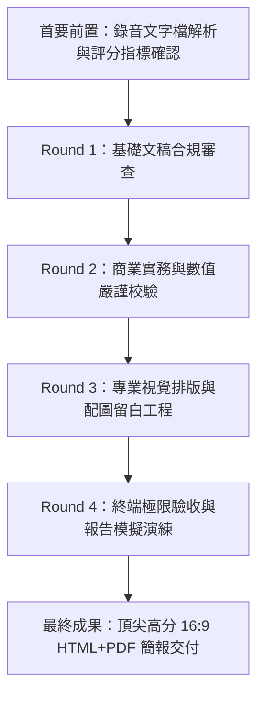

# 品牌期中簡報系統全面完善企劃書
## SUKIYA すき家 16:9 高階五頁簡報系統

> **專案目標**：將現有 `brand_presentation.html` 網頁簡報，以「4 輪漸進提升嚴格標準」之迴圈式工程作業，全面修正至 100% 契合課堂錄音、老師評分準則、商業事實無落差，並落實專業設計規格與配圖留白機制。

---

## 一、 專案核心執行架構與 4 輪迴圈機制

---

## 二、 4 輪迭代任務目標與逐輪標準提升階梯

| 迭代輪次 | 審查與強化主題 | 執行標準與交付目標 | 預期檢核產出 |
| :--- | :--- | :--- | :--- |
| **Round 1** 基礎文稿合規 | **對齊錄音 5 大頁框架** | • 逐頁比對錄音中老師 5 頁核心規範，刪除多餘定義。 • 確保第 1 頁極簡化、第 2 頁產品五層次到位、第 3 頁反推 TA、第 4 頁二維圖、第 5 頁劉冠廷神隊友。 • 嚴格防範「城市行銷」內容侵入。 | 完整 5 頁文字稿合規校對清單 |
| **Round 2** 商務深度無落差 | **SUKIYA 商業實況校正** | • 深度核對日本 ZENSHO 集團財報與台灣すき家現況（門市數、橫濱 1982 年起家、MMDS 冷鏈體系）。 • 第 2 頁科特勒五層次定義精確，避免空泛宣傳詞。 • 第 3 頁真實秋季廣告（$154 芡汁玉子丼）與受眾情境嚴格對齊。 • 第 4 頁競品（吉野家、松屋、三商巧福、大戶屋）落點數據化。 | 零誤差商業事實審核對照表 |
| **Round 3** 專業視覺與留白 | **專業設計師介面適配** | • 落實需求：**需真實素材處直接留白，並標註清晰提示文字與建議規格**。 • 第 1 頁（門市招牌實拍留白處）、第 2 頁（MMDS供應鏈/動線圖留白處）、第 5 頁（劉冠廷神隊友形象照留白處）。 • 第 3 頁保留手機外框並與真實廣告圖無縫契合。 • 16:9 畫布字體階級、間距、色彩對比度精準調整。 | 視覺排版與留白佔位元件上線 |
| **Round 4** 極限評估與演練 | **答辯與 5 分鐘控時** | • 逐頁演練講稿，確保每頁平均 60 秒、總時長精準控制在 4 分 45 秒～ 5 分鐘內。 • 側邊抽屜講稿與主畫面資訊 100% 呼應，提供講者即看即講能力。 • 驗證 PDF 匯出無位移、無截斷。 | 瀏覽器實測驗收錄影與截圖 |

---

## 三、 五大投影片專業配圖留白（Placeholder）規劃

依據需求規範，簡報中需要實際圖片素材之區塊，將以專業設計師規格之「精緻導引留白槽（Design Placeholder）」呈現：

1. **Slide 01 品牌視覺留白槽**：
   - **尺寸比例**：16:9 橫幅高畫質視窗。
   - **指引文字**：`【建議配圖】：SUKIYA 台灣門市外觀實景照（具備清晰發光之黃底紅字「すき家」碗型招牌與深色日式木質/紅磚外牆），或經典牛丼搭配味噌湯套餐擺盤特寫。建議尺寸 1200×675 以上。`
2. **Slide 02 核心競爭力佐證留白槽**：
   - **尺寸比例**：4:3 示意卡片。
   - **指引文字**：`【建議配圖】：ZENSHO MMDS（製造販賣垂直整合體系）冷鏈物流車隊或店內開放式廚房 30 秒出餐標準動線示意圖，強化不可替代之組織壁壘。`
3. **Slide 03 廣告手機實例**：
   - 已成功適配真實官方臉書廣告截圖 `sukiya廣告fb.jpg`，外層保留完整金屬質感智慧型手機外框。
4. **Slide 05 擬人化代言對標留白槽**：
   - **尺寸比例**：1:1 正方形人物肖像。
   - **指引文字**：`【建議配圖】：演員「劉冠廷」親切溫暖、挽起袖子之生活感幹練形象照（建議避免過度華麗之紅毯正裝，凸顯「親民踏實、隨時都在」之國民神隊友精神）。`

---

## 四、 執行甘特流程

1. **第 1 輪作業**：文稿逐字嚴密比對 ➔ 產出文字修訂草稿。
2. **第 2 輪作業**：針對數據事實深度校正 ➔ 更新 `brand_presentation.html` 資料層。
3. **第 3 輪作業**：植入「配圖留白引導槽」樣式與結構 ➔ 調整 CSS 階級與排版。
4. **第 4 輪作業**：瀏覽器即時渲染驗證 ➔ 測試 16:9、演講稿同步性、PDF 下載完整性。
